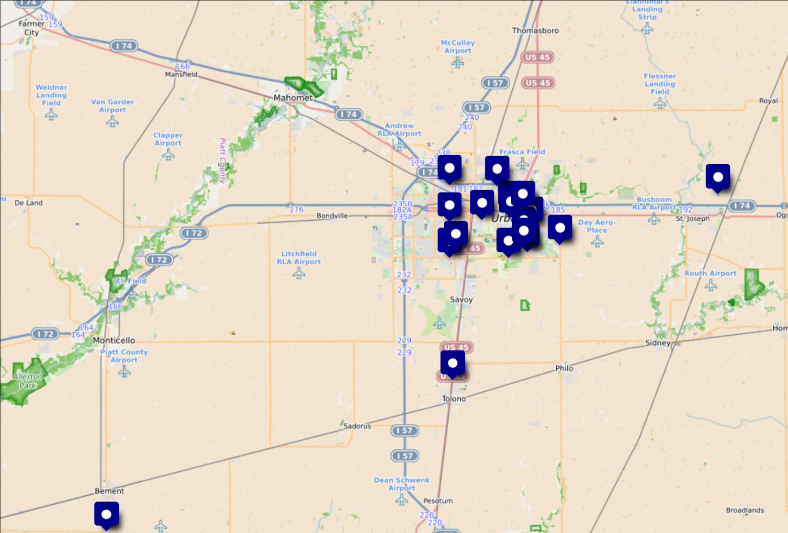

View [rendered](https://htmlpreview.github.io/?url=https://github.com/gnulug/meetings/2026f/2026-2026-09-30/README.html)

View [source](https://github.com/gnulug/meetings/2026f/2026-2026-09-30/README.html)

```
# Compile me locally with:
pandoc --standalone --to=revealjs --output=README.html README.md
```

--------

## Problems of centralized communication

- Single point-of-failure
- Surveillance
- Coverage

In contrast, Meshtastic is decentralized

--------

## Use cases

- Fun around town
- Road trips
- Hiking
- Emergencies?
  - Compare with Ham (UWF/VHF/HF)
- IOT
- Protests

--------

## LoRA protocol

- LoRA "chirps"

{ height=200px }
{ height=200px }

--------

## Meshtastic protocol

- Every node _can_ be a repeater
- But proto smartly chooses when to repeat (node role + listen first)
- Flood routing
- Max hop count
- Crypto built-in!

--------

## Meshtastic protocol

- Channels
  - Symmetric encryption
  - Message delivery status: nobody, somebody, (no 'everybody')
- DMs
  - Asymmetric encryption
  - Message delivery status: nobody, somebody, that person
- Remote administration
- Other data packets

--------


--------

## Hardware

{ height=300px }
{ height=300px }

nRF52 vs ESP32

Battery life?

--------

## Cool tricks

- MQTT
- <https://meshmap.net/>

--------


## Local big nodes

- South: Riggs, Meijer, and Vine/McHenry
- North: 5 points, King's Court
- Middle: Currently lacking, Family Dollar coming soon
- Potential future nodes
  - Bongard grain silo?
  - IMC

--------



[source](https://umap.openstreetmap.fr/en/map/semi-permanent-meshtastic-nodes-in-central-illinoi_1364119#11/40.072574/-88.300896)

--------

## Local Mesh community

- [CU 2600](https://cu2600.org/)
- [Central IL Mesh Discord](https://discord.gg/j4gf8Msah)
- [Central IL Mesh Matrix](https://matrix.to/#/#meshtastic:hax0rbana.org)
  - [Public chatroom mirror](https://matrix.to/#/#meshtastic_longfast:hax0rbana.org)
- [ChicagoLandMesh](https://chicagolandmesh.org/)
